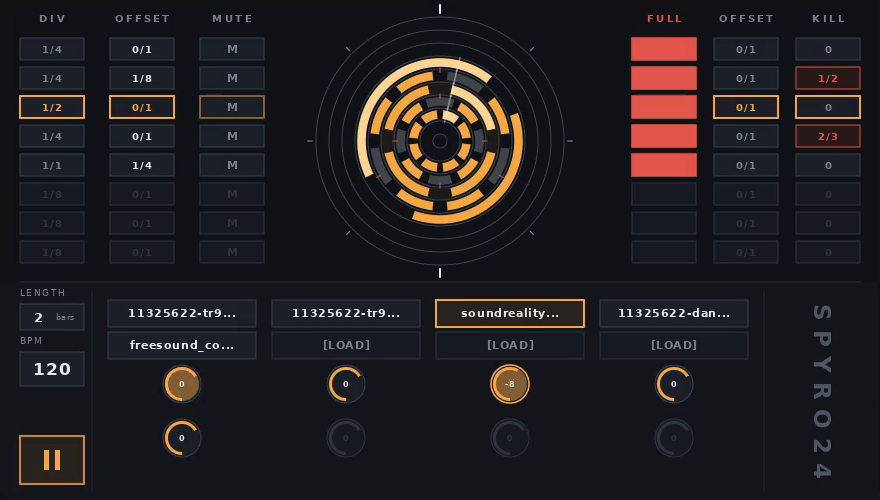

# Circular Drum Machine

A hand-drawn circular drum machine: eight tracks of samples, each with a ring
around the centre where its hits live. Divisions set the spacing, offsets set
the phase, and a separate kill grid cuts hits out of the loop.



The whole interface is drawn in software into an 880×500 canvas — no widget
toolkit, no rounded corners, every arc and digit rasterised by `src/draw.c`.
The same canvas is what the VST3 plugin puts in front of the host, so the app
and the plugin look and behave identically.

## What it does

* **Eight tracks**, each with its own sample and ring row.
* **Ring sequencer.** Each track has a `DIV` (how often it hits) and an
  `OFFSET` (where its grid starts, as a ratio; `0/1` means no offset). Hits are
  laid out on a 1/96-note grid, so everything stays musically exact.
* **MUTE** silences a track without touching its level: the ring and pad are
  drawn as if the track were empty.
* **KILL grid.** Its own `OFFSET`, its own `KILL` division, and `FULL` to
  decide whether a kill cancels just the hit's tick or its whole step.
  `KILL 0` switches the grid off. A hit starting on a kill's tick is always
  cancelled; with `FULL` on, a kill starting anywhere inside the hit's step
  cancels it too.
* **Length and tempo.** `LENGTH` in bars and `BPM`; the loop wraps and the
  phase carries over, so a pattern stays put while you change the length.
* **Eight sample slots** in two rows of four. A slot reads `[LOAD]` until it
  holds a sample; click it to browse, or drop a `.wav`/`.mp3` onto the slot
  under the cursor.
* **Eight pads** for the tracks: drag up and down for level, from −∞ to
  +10 dB, with 0 dB at two thirds of the travel.

The `DIV`, `OFFSET` and `KILL` boxes are text fields: click one and type, `3/16`
or a bare `3` for 1/3. Enter commits and moves to the next row, Esc reverts, and
scrolling a box instead steps it through the usual note values. `LENGTH` steps a
bar at a time when clicked; `BPM` and the pads are dragged up and down.

## Running it

```sh
./build/linux/circular_drum_machine
```

Click a slot, load a sample, then press play. Scroll a track's `DIV` box to
change how often it hits — or click it and type `1/8` — and the arcs redraw as
you go. Clicking a ring only selects its track: the rings show the grid, they do
not edit it.

Headless render, useful for checking a layout change:

```sh
./build/linux/circular_drum_machine --dump frame.png
```

## Building

Dependencies, the VST3 SDK fetch, the Windows/CI path and all four artifacts
(standalone and plugin, Linux and Windows) are described in
[BUILDING.md](BUILDING.md). The short version:

```sh
./scripts/build-linux.sh          # standalone + VST3, into build/linux
./scripts/build-windows.sh all    # on Windows/msys2, or from the CI workflow
```

To let a host see the plugin:

```sh
ln -s "$PWD/build/linux/VST3/Release/circular_drum_machine_vst3.vst3" ~/.vst3/
```

The plugin is a single-component instrument: the host's transport runs the
loop, and the tail of a sample keeps ringing after the host stops.

## Layout of the source

| path | what it is |
| --- | --- |
| `src/audio.c` | pattern clock and sample mixer — no windowing, no SDL |
| `src/audio_sdl.c` | SDL2 audio device for the standalone only |
| `src/draw.c` | software rasteriser: arcs, rects, anti-aliased text |
| `src/ui.c` | the interface: layout, input, typed ratio fields, browser |
| `src/main.c` | standalone shell — window, GL context, event loop, `--dump` |
| `src/vst3/` | the plugin, plus one editor backend per platform (`view_x11.cpp`, `view_win.cpp`) |
| `src/compat/` | `dirent.h` shim so the sample browser builds with mingw |

The engine keeps its own transport clock and renders from a snapshot of the
kit pushed by the interface, so a hit lands on the exact frame rather than
whenever the redraw happened to catch it. The plugin feeds that same mixer
from the host's process callback.

## State

Both platforms build in CI, and the Linux plugin passes the SDK validator. What
is still untested is a real host: no DAW has loaded either plugin yet, so the
editor, input forwarding and host transport are unverified outside the validator,
and nothing here has been run on Windows itself.
